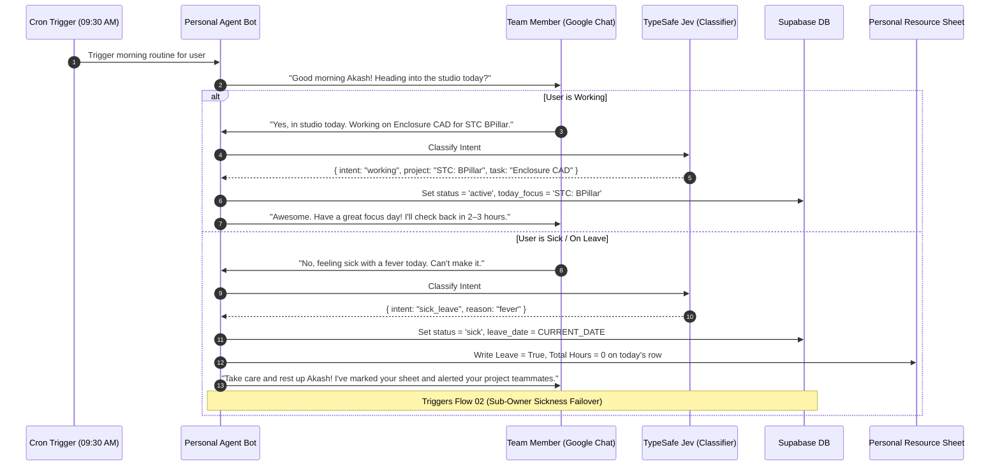

# Flow 01: Morning Check-in & Sickness Reporting

*The daily automated check-in initiated by the personal agent on Google Chat.*

---

## 1. Sequence Flow Diagram



---

## 2. Google Chat Interactive Card UI

### A. Morning Check-in Card (Pushed at 09:30 AM)
```
┌──────────────────────────────────────────────┐
│  ☀️ BangOps Assistant • Morning Check-in     │
├──────────────────────────────────────────────┤
│ Good morning Akash! Heading into the studio  │
│ today?                                       │
│                                              │
│ [ 🏢 Yes, In Studio ]   [ 🏠 Remote ]        │
│ [ 🤒 Sick Leave ]       [ 🏖 Personal Leave ]│
└──────────────────────────────────────────────┘
```

### B. Sick Leave Confirmation Card
```
┌──────────────────────────────────────────────┐
│  🤒 Leave Recorded                           │
├──────────────────────────────────────────────┤
│ Rest up Akash! We've got your back today.    │
│                                              │
│ • Resource Sheet: Marked Leave = True (0h)   │
│ • Active Projects: STC: BPillar, Nexa        │
│ • Sub-owner Sarah has been alerted to cover. │
│                                              │
│ Need to pass a quick voice/text note to team?│
│ [ ✍️ Add a Quick Note ]                       │
└──────────────────────────────────────────────┘
```
