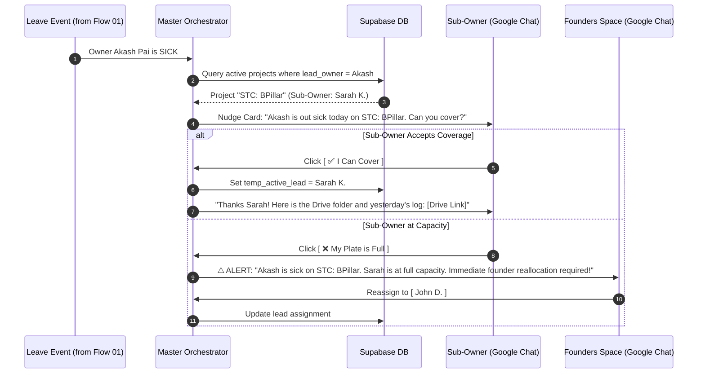

# Flow 02: Sub-Owner Sickness Failover Protocol

*Autonomous capacity routing when a primary project owner reports sick.*

---

## 1. Sequence Flow Diagram



---

## 2. Google Chat Interactive Card UI

### Sub-Owner Stand-in Request Card
```
┌──────────────────────────────────────────────┐
│  ⚠️ Project Coverage Request                 │
├──────────────────────────────────────────────┤
│ Hey Sarah, Akash is out sick today.          │
│                                              │
│ Project: STC: BPillar                        │
│ Next Milestone: Enclosure CAD Review         │
│ Drive Folder: drive.google.com/...           │
│                                              │
│ Do you have capacity to cover urgent tasks   │
│ on this project today?                       │
│                                              │
│ [ ✅ Yes, I Can Cover ]  [ ❌ Plate is Full ]│
└──────────────────────────────────────────────┘
```

### Founder Escalation Card (Triggered if Sub-owner declines)
```
┌──────────────────────────────────────────────┐
│  🚨 Urgent Project Coverage Alert            │
├──────────────────────────────────────────────┤
│ Project: STC: BPillar                        │
│ Lead Owner: Akash Pai (Out Sick)             │
│ Sub-Owner: Sarah K. (Declined - At Capacity) │
│                                              │
│ Action Required: Please assign a temporary   │
│ lead or notify client of schedule shift.     │
│                                              │
│ [ 🔄 Reassign to Colleague ] [ 📩 View Thread]│
└──────────────────────────────────────────────┘
```
