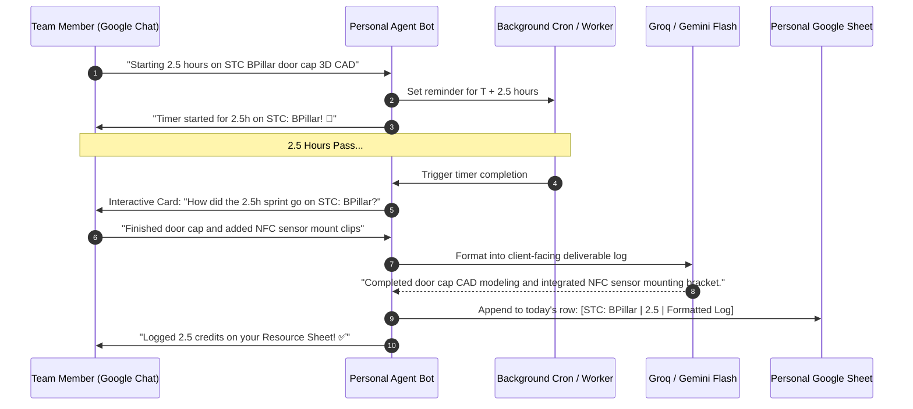

# Flow 03: Pomodoro Focus Timer & Credit Logging

*Lightweight 2–3 hour focus sprints in Google Chat with automated timesheet logging.*

---

## 1. Sequence Flow Diagram



---

## 2. Google Chat Interactive Card UI

### A. Focus Sprint Completion Prompt
```
┌──────────────────────────────────────────────┐
│  ⏱️ Sprint Complete • STC: BPillar (2.5h)     │
├──────────────────────────────────────────────┤
│ Your 2.5-hour focus block is complete.       │
│ Did you wrap up your planned CAD milestones? │
│                                              │
│ [ ✅ Complete & Log ]    [ ⏱️ Need +1 Hour ] │
│ [ 🔄 Switch Project ]    [ ❌ Discard Timer ]│
└──────────────────────────────────────────────┘
```

### B. Auto-Formatted Timesheet Write Confirmation
```
┌──────────────────────────────────────────────┐
│  📊 Credits Logged Successfully              │
├──────────────────────────────────────────────┤
│ Appended to Resource_Akash_Pai.xlsx:         │
│                                              │
│ • Date: 19 Sep 2026                          │
│ • Project: STC: BPillar                      │
│ • Hours: 2.5 Credits                         │
│ • Client Log: "Completed door cap CAD        │
│   modeling and integrated NFC sensor mount." │
│                                              │
│ Today's Total: 5.5 / 7.0 Credits             │
└──────────────────────────────────────────────┘
```
