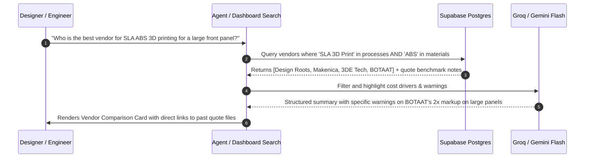

# Flow 04: Vendor Search & Quoting Intelligence

*Searching fabrication suppliers, materials, lead times, and avoiding pricing traps directly from chat or dashboard.*

---

## 1. Sequence Flow Diagram



---

## 2. Google Chat Interactive Card UI

### Vendor Recommendation Card
```
┌──────────────────────────────────────────────┐
│  🔍 Vendor Recommendation • SLA ABS 3D Print │
├──────────────────────────────────────────────┤
│ 🏆 Best Pick: Design Roots                   │
│ • Price: Budget ($) | Quality: ★★★★☆ (4.5)   │
│ • Lead Time: 3–4 Days | City: Bangalore      │
│ • Quoted Rate: ₹37,940 for large front panel │
│ • Contact: +91 98450 XXXXX (Mr. Ramesh)      │
│                                              │
│ ⚠️ Important Benchmark Warning:              │
│ Avoid BOTAAT for large enclosure panels.     │
│ In recent quotes, BOTAAT priced the front    │
│ panel at ₹81,240 (over 2x more expensive).   │
│                                              │
│ [ 📁 View Past Quotes ]  [ ✉️ Draft RFQ Email ]│
└──────────────────────────────────────────────┘
```
