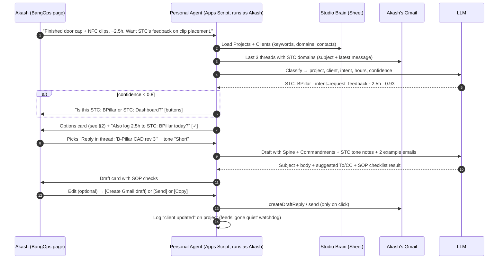

# Flow 06: Work Note → Client Email (with approval)

*The core v1 flow. Someone tells the agent what they did in plain words. The agent works out the project and client, offers a few ways to write to the client, drafts a Spine-compliant email, and the person copies it, saves it as a Gmail draft, or sends it on approval.*

Surface: BangOps web app (see [`architecture-v2-workspace-native.md`](../docs/architecture/architecture-v2-workspace-native.md)).

---

## 1. Sequence



---

## 2. What the person sees

**Options card** (each is a click, not a typed choice)

```
STC: BPillar  ·  client: STC (Rahul Mehta, rahul@stc…)       [change]

How do you want to write to them?
( ) Reply in thread "B-Pillar CAD rev 3" (last msg 2 days ago)
( ) New email: progress update + feedback request
( ) New email: files sent + next-morning follow-up reminder

Tone:  [Standard]  [Short]  [Detailed]
Include:  [✓] hours (2.5h)   [ ] schedule impact   [✓] ask for decision by date

[Draft it]
```

**Draft card**

```
Subject: B-Pillar — door cap and NFC clip update, feedback requested

Dear Rahul,

What I have done: I have completed the door cap CAD and added the NFC sensor mounting clips …
Why: …
How this benefits you: …
Effort: This update took approximately 2.5 hours.
Next step: Could you confirm the clip placement by Monday 29 Sep so we can proceed to the print file?

Best regards,
Akash

SOP check:  ✓ Spine   ✓ effort quantified   ✓ clear next step   ⚠ mentions a date: confirm it with whoever does the next step (C11)
To: rahul@…   CC: (suggest sub-owner Sarah)          [Copy]  [Create Gmail draft]  [Send]  [Revise ▾]
```

---

## 3. Rules

- **Never sends without a click.** "Send" is only offered after the draft has been shown in full.
- **Commandment 11 guard.** If the draft promises a date or names a colleague, show a warning and suggest CC'ing that person. Don't block, but make them tick "confirmed with them".
- **No invented facts.** The draft can only use: the person's note, the thread, and the Studio Brain. Missing information (e.g. hours) is asked for, never guessed.
- **Side effect offered, not done:** "Log 2.5h to STC: BPillar?" only writes to the Resource Sheet if ticked (it feeds Flow 08).
- **Revise ▾:** shorter / more formal / add schedule impact / turn into file follow-up (template B).

## 4. Prompt ingredients (in this order)
1. Studio SOP (Spine + Commandments + Never/Always list).
2. Client tone notes + 1–2 rated example emails for this client or situation.
3. Thread context: last message + 3-line summary (not the full history).
4. The person's note + chosen option + tone + includes.
5. Output schema: `{subject, body, to[], cc[], sop_checks[], questions_for_user[]}`.
