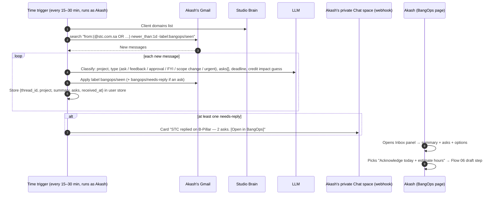

# Flow 07: Inbound Client Email → Summary → Reply Options

*The agent notices when a client emails you, tells you in Google Chat, and has reply options ready. It watches only your own inbox, only threads from known client domains, and stores summaries rather than email bodies.*

---

## 1. Sequence



---

## 2. Chat card (short)

```
STC · B-Pillar — Rahul replied (6:40 pm)
• Move NFC clip 4 mm inward
• Wants the updated STEP file by Friday
Suggested: same-day acknowledgement (C1) with an hours estimate (C6)
[Open in BangOps]
```

## 3. Reply options offered in the Inbox panel
1. **Acknowledge now:** "Received, here's the plan and effort" (Commandments 1 + 6).
2. **Answer fully:** draft a reply that addresses each ask.
3. **Flag schedule impact:** Commandment 5 template, with hours and the milestone shift.
4. **Internal first:** draft the handover/coordination message to the owner or sub-owner (template C) before replying to the client.
5. **No reply needed:** mark handled.

## 4. Rules
- **Scope:** only senders whose domain is in Studio Brain → Clients. Everything else is ignored.
- **Storage:** summaries, asks, and thread IDs only. Bodies are fetched fresh when drafting.
- **Nudge budget:** at most one card per thread per day, and at most 4 cards per person per day (they get batched into a single message if there are more). No cards outside working hours: evening mail gets sent at 9:30 the next morning, unless it's tagged *urgent*.
- **Gone-quiet watchdog (later):** a `needs-reply` item older than 1 working day → gentle reminder. Files sent yesterday with no reply → prompt to send the file follow-up (template B).
